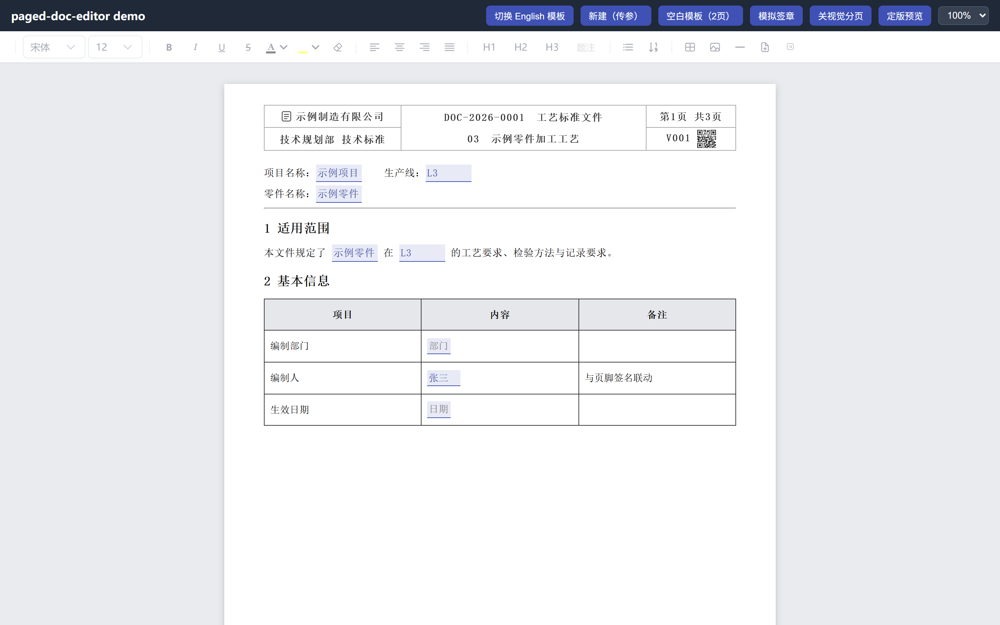
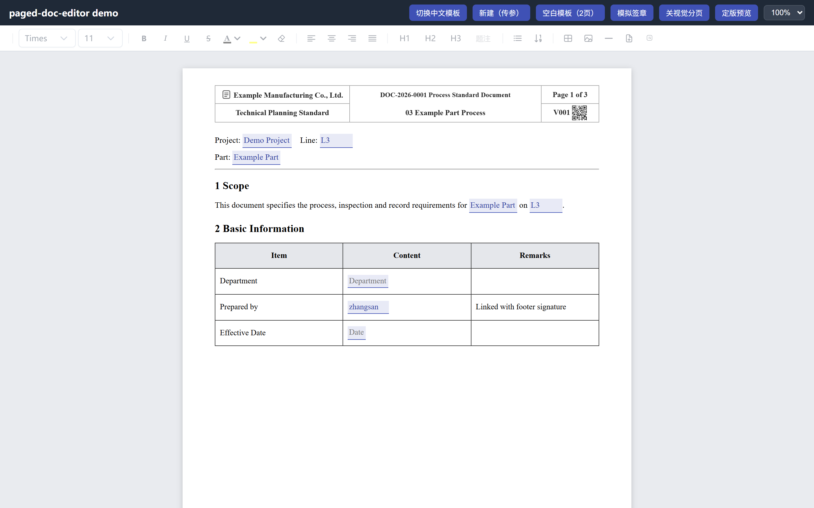

# paged-doc-editor

分页文档编辑器（Tiptap v3 + Vue 3）：多节版式、所见即所得分页、页眉页脚（奇偶变体）、
模板传参、逐级签章，配套服务端定版渲染管线一键导出盖章 PDF。

## 演示

| 中文示例 | 英文示例 |
|---|---|
|  |  |

渲染管线输出的定版 PDF 样例（带页眉页脚、全局连续页码、四级签章）：
[docs/sample-zh.pdf](docs/sample-zh.pdf) · [docs/sample-en.pdf](docs/sample-en.pdf)

## 特性

- **多节版式**：每节独立纸张（A4/A3）、方向、页边距、页眉页脚，混排一份文档
- **软分页**：编辑态视觉分页与导出 PDF 逐页一致（同一页面几何引擎 `computePageLayout`）
- **页眉/页脚**：奇偶页变体、3列×2行标题栏、版本号 + 二维码、节级锁定
  （`headerEditable/footerEditable`），锁定区由 `LockedRegionGuard` 防误删
- **模板传参**：`fillParams` 填充 `{{key}}` 占位，字段跨表/跨节联动（bindKey），默认值回填
- **签章**：`{{sig:role}}` 占位逐级回填（中文 KaiTi 正楷 / 英文 Times 斜体 SVG 签名），
  `{{sigDate}}` 自动取最后审批日期；`resetSignatures` 支持驳回重签
- **中英文双模板**：单一 LABELS 事实源双语生成；英文文档 Times 优先字体栈
- **定版渲染**：服务端 puppeteer + pdf-lib，全局连续页码盖章（嵌入 Noto Serif 数字子集）、
  奇偶页交错合并、文档内部链接展开为绝对 URI
- **CAD 图纸**：插入 DXF（基于 mlightcad），白底黑白预览快照，双击弹窗编辑写回
- **表格加固**：跨页劈行、衬垫行、格底色、浮动行列手柄

## 快速开始

```bash
npm install
npm run dev            # demo：http://localhost:8100（?lang=en 冷启动英文示例）
```

导出 PDF 演示（第二个终端）：

```bash
npm run render-server  # 渲染服务：http://localhost:8200
```

然后在 demo 页右键 →「定版预览 / 导出 PDF」，即可得到带页眉页脚、全局页码、签章的定版 PDF。

## 作为库集成

```js
import { SectionedEditor, buildTemplateSections, fillParams, applySignatures } from 'paged-doc-editor';
import 'paged-doc-editor/styles';

const sections = ref(fillParams(buildTemplateSections('zh'), {
    stdName: '工艺标准文件', stdNo: 'DOC-2026-0001', verNo: 'V001',
    chapNo: '03', chapName: '示例章节', preparedBy: '张三'
}));
```

```vue
<SectionedEditor :sections="sections" :editable="true" :zoom="1" ref="ed" />
```

`ed.value.getPayload()` 得到可提交渲染的 sections JSON。

peerDependencies：`vue ^3.4`、`primevue ^4.2`、`primeicons`、`@primevue/themes`。

### 渲染服务（可选）

`src/server/render.js` 导出 `initRender()` / `renderDocument(sections, opts)`，
可直接 import 进宿主后端；或起 `server/render-server.js`（express 薄壳，`POST /render`）。

渲染依赖 `puppeteer`（声明为 optionalDependency，只在前端用库时可不装）：

```bash
npm install puppeteer
```

`renderDocument` 选项：`lang`（'zh'/'en'）、`docBaseUrl`/`siteBaseUrl` + `docLinkPath`/`siteLinkPath`
（把正文里的相对文档链接展开成绝对 URI，PDF 批注才能存活）。

## 字体说明（重要）

本仓库**不分发任何 proprietary 字体**。中文排版默认引用 `SimSun/宋体`、`SimHei/黑体`、`KaiTi/楷体`
字体名——这些字体需由运行环境（浏览器所在系统 / 渲染服务器）自行安装：

- 桌面浏览器：Windows 自带宋体/黑体/楷体即可
- 渲染服务器（Linux 容器）：需安装中文字体，推荐开源替代 **思源宋体/黑体（Source Han / Noto CJK，OFL）**
  并把 CSS 字体栈中的字体名替换为你的部署名

唯一随仓库分发的字体是 `src/server/assets/notoserif-digits.ttf`——Noto Serif（SIL OFL 1.1）
的 0-9 数字子集（2.5KB），仅用于 PDF 全局页码盖章。

## CAD 支持

CAD 图纸插入基于 mlightcad（MIT），**仅支持 DXF**。

- **字体/模板资源**：mlightcad 运行时需要 SHX/woff 字体仓（默认从 CDN 拉取）。
  内网/离线部署时，宿主需自备 `cad-data` 目录并在挂载时传 `cadDataBaseUrl`（见 `src/editor/cad/mlightcadMount.js`）。
  注意多数 SHX 字体与 AutoCAD 模板版权属 Autodesk，请自行确认分发权利。
- **DWG**：需要 GPL-3.0 许可的 `@mlightcad/libredwg-web` 转换器。本包（MIT）不内置 DWG 支持；
  如确需 DWG，请自行安装该 GPL 包并在宿主侧注册转换器（注意 GPL 对衍生作品的分发要求）。

## 项目结构

```
src/editor/        编辑器包本体（组件 / tiptap 扩展 / 页面几何引擎 / 模板 / 样式）
src/server/        定版渲染管线（render.js，可独立 import）
src/demo/          演示壳（模拟宿主集成）
server/            渲染服务 express 薄壳（:8200）
tests/             check-*.mjs 单测（npm test）+ smoke-*.mjs 渲染冒烟（需 render-server）
```

## 测试

```bash
npm test                          # 纯 node 单测（布局引擎 / 表格 / 图片 / 列表渲染）
npm run render-server             # 另起终端
node tests/smoke-zh.mjs           # 中文模板 → 签章 → PDF（产物在 tests/out/）
node tests/smoke-en.mjs           # 英文模板 + 页眉页脚几何探针 → PDF
```

## License

MIT（见 LICENSE）。第三方依赖许可各自保留；`notoserif-digits.ttf` 按 SIL OFL 1.1 分发。
